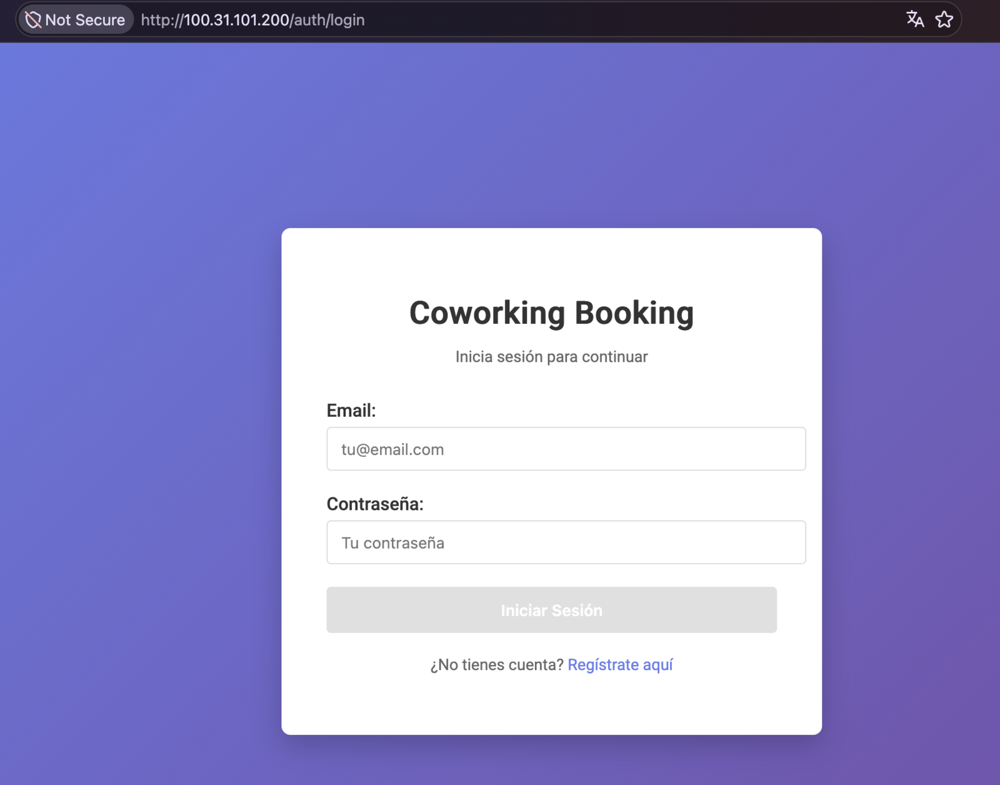
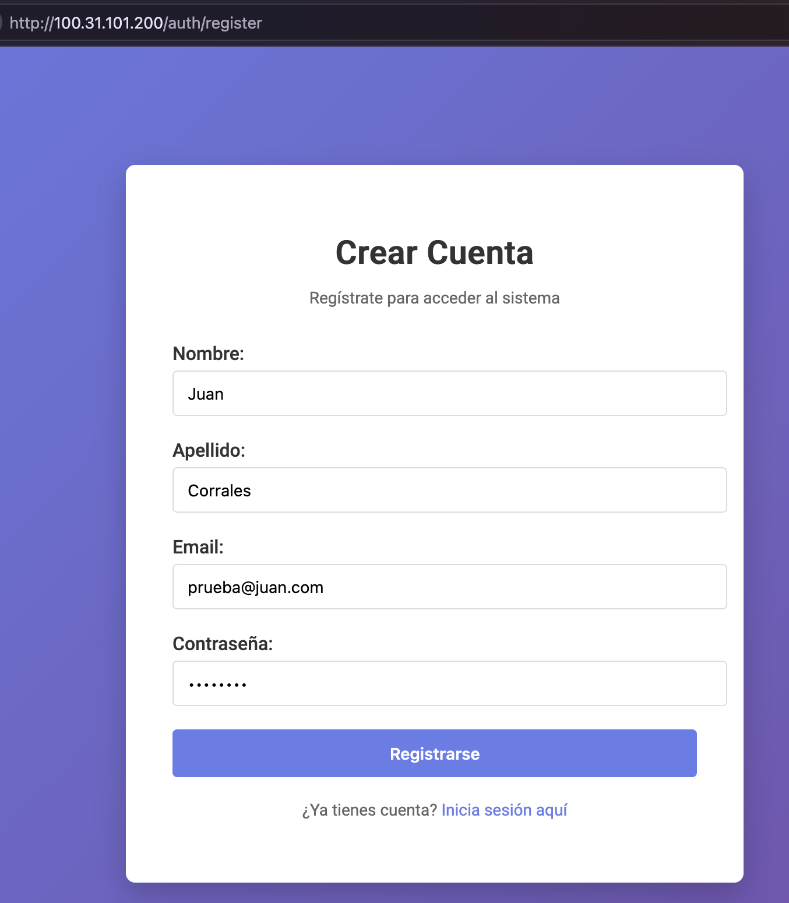
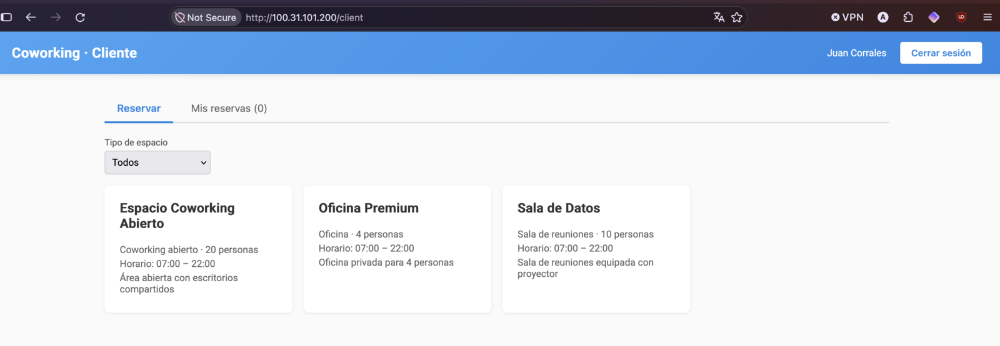
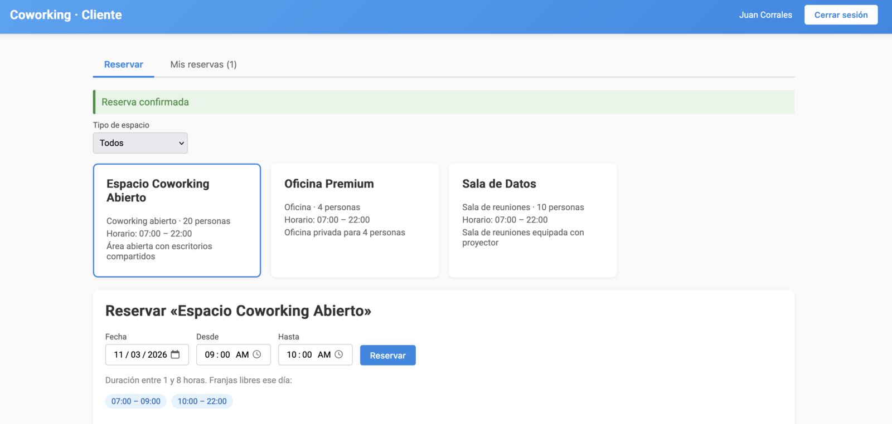
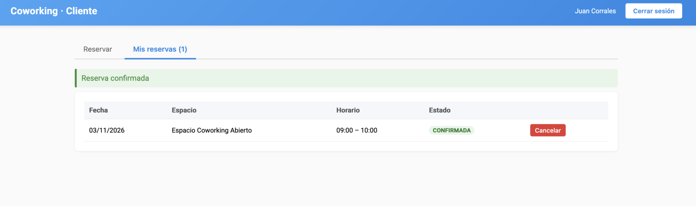
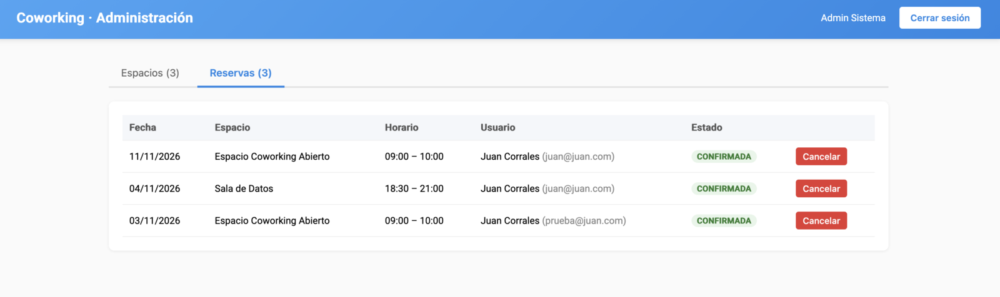

# Coworking Booking System

Una aplicación web para reservar espacios en un coworking: oficinas privadas, salas de reuniones
y zonas de escritorios compartidos. La persona entra desde el navegador, elige un espacio, ve qué
horas quedan libres ese día y lo reserva. Así se evita que dos personas reserven el mismo espacio
a la misma hora.

Puedes probarla en **https://coworking.davidcorrales.dev/**. Está publicada en un servidor de AWS y funciona
mientras ese servidor esté encendido.

## Cómo se usa

### 1. Iniciar sesión

Cada persona entra con su correo y su contraseña. Si todavía no tiene cuenta, puede crearla desde
el enlace "Regístrate aquí".



### 2. Crear una cuenta

Para registrarse basta con el nombre, el apellido, un correo y una contraseña. Al terminar, la
persona entra directamente a la aplicación como cliente.



### 3. Elegir un espacio

El cliente ve todos los espacios disponibles con su tipo, cuántas personas caben, el horario de
apertura y una breve descripción. La lista se puede filtrar por tipo de espacio.



### 4. Hacer la reserva

Al elegir un espacio aparece un formulario con la fecha y la hora de inicio y de fin. Debajo se
muestran las franjas libres de ese día, para que sea fácil escoger una hora que no esté ocupada.
Cada reserva dura entre 1 y 8 horas. Si todo está bien, aparece el aviso "Reserva confirmada".



### 5. Ver y cancelar mis reservas

En la pestaña "Mis reservas" el cliente ve sus reservas con la fecha, el espacio, el horario y el
estado. Desde ahí puede cancelar cualquiera de ellas.



### 6. Panel de administración

El administrador tiene su propio panel. Ve las reservas de todos los clientes, con el nombre y el
correo de quien reservó, y puede cancelarlas. En la pestaña "Espacios" crea, edita y elimina los
espacios del coworking.



## Dónde está publicada

La aplicación corre en Amazon Web Services (AWS). La página y el servidor que procesa las reservas
están empaquetados con Docker, una herramienta que hace que el programa funcione igual en cualquier
computador. Ese paquete corre en un servidor virtual de AWS (EC2), y los datos (usuarios, espacios
y reservas) se guardan en una base de datos PostgreSQL administrada por AWS (RDS).

---

# Para desarrolladores

## Stack

| Capa | Tecnología |
|---|---|
| Backend | Java 21, Spring Boot 3.3, Spring Security (JWT HS256), Spring Data JPA, Flyway |
| Frontend | Angular 17 |
| Base de datos | PostgreSQL 16 |
| Infraestructura | Docker, Docker Compose, nginx, GitHub Actions, AWS EC2 + RDS |

## Estructura

```
coworking-booking/
├── backend/                 # API REST Spring Boot
├── frontend/                # SPA Angular (servida por nginx, que hace proxy de /api)
├── docker-compose.yml       # Entorno local
├── docker-compose.prod.yml  # Producción (EC2)
├── .env.example             # Variables de entorno (local y producción)
├── docs/img/                # Capturas usadas en este README
├── .github/workflows/ci.yml # CI: tests + build
├── ARCHITECTURE.md          # Diseño
├── DEPLOYMENT.md            # Despliegue en AWS
└── SPEC_AUTH.md             # Especificación de autenticación
```

## Arrancar en local

### Opción A: todo con Docker (recomendada)

Requisito: Docker.

```bash
cp .env.example .env   # rellena DB_PASSWORD, JWT_SECRET y ADMIN_PASSWORD
docker compose up --build
```

- App: http://localhost
- API: http://localhost:8080/api · Swagger: http://localhost:8080/swagger-ui.html
- Health: http://localhost:8080/actuator/health

Usuario admin de desarrollo: `admin@coworking.com` / el `ADMIN_PASSWORD` de tu `.env`
(los clientes se crean desde la pantalla de registro).

Para empezar con la base de datos vacía: `docker compose down -v`.

### Opción B: desarrollo con recarga en caliente

Requisitos: Java 21, Maven 3.9+, Node 22.

```bash
docker compose up -d postgres            # solo la base de datos

cd backend && mvn spring-boot:run        # API en :8080 (exporta SPRING_PROFILES_ACTIVE=dev, DB_PASSWORD y JWT_SECRET)
cd frontend && npm ci && npm start       # SPA en http://localhost:4200 (proxy de /api a :8080)
```

## Tests

```bash
cd backend && mvn test                   # JUnit 5 + Mockito + MockMvc
cd frontend && npm run test:ci           # Karma (Chrome headless)
```

## Despliegue

Ver [DEPLOYMENT.md](DEPLOYMENT.md): imágenes en Docker Hub, EC2 con Docker Compose y base de datos en RDS.

---

## API

Todas las respuestas siguen el mismo formato:

```json
{ "success": true, "message": "…", "data": { … }, "timestamp": "…" }
```

En caso de error `success` es `false`; los errores de validación detallan cada campo en `data`.
Salvo `/api/auth/**`, todos los endpoints requieren `Authorization: Bearer <token>`.

### Autenticación — ver [SPEC_AUTH.md](SPEC_AUTH.md)

| Método | Ruta | Descripción | Códigos |
|---|---|---|---|
| POST | `/api/auth/register` | Crea un cliente y devuelve token | 201, 400, 409 |
| POST | `/api/auth/login` | Devuelve token + usuario | 200, 400, 401 |

### Espacios

| Método | Ruta | Rol | Descripción |
|---|---|---|---|
| GET | `/api/espacios?page=0&size=10&tipo=OFICINA` | Cualquiera | Listado paginado (`size` máx. 100) |
| GET | `/api/espacios/{id}` | Cualquiera | Detalle |
| GET | `/api/espacios/{id}/disponibilidad?fecha=YYYY-MM-DD` | Cualquiera | Franjas libres del día |
| POST | `/api/espacios` | ADMIN | Crear |
| PUT | `/api/espacios/{id}` | ADMIN | Actualizar |
| DELETE | `/api/espacios/{id}` | ADMIN | Eliminar (solo si no tiene reservas) |

`tipo`: `OFICINA`, `SALA_REUNIONES`, `COWORKING_ABIERTO`.

```json
{ "nombre": "Sala Azul", "descripcion": "…", "tipo": "SALA_REUNIONES", "capacidad": 8,
  "horarioApertura": "07:00", "horarioCierre": "22:00" }
```

### Reservas

| Método | Ruta | Descripción |
|---|---|---|
| GET | `/api/reservas?page=0&size=10` | CLIENT: sus reservas · ADMIN: todas |
| POST | `/api/reservas` | Crear reserva para el usuario autenticado |
| DELETE | `/api/reservas/{id}` | Cancelar (propia, o cualquiera si ADMIN) |

```json
{ "espacioId": 1, "fecha": "2026-11-05", "horaInicio": "09:00", "horaFin": "11:00" }
```

Reglas de negocio:
- Duración entre **1 y 8 horas**, dentro del horario del espacio.
- No se puede reservar en el pasado (según `APP_TIMEZONE`).
- No puede solaparse con otra reserva confirmada del mismo espacio (protegido también
  frente a peticiones concurrentes con un bloqueo de fila).
- Cancelar marca la reserva como `CANCELADA` (no se borra).

### Códigos de error

| Código | Cuándo |
|---|---|
| 400 | Validación, regla de negocio o cuerpo/parámetro mal formado |
| 401 | Sin token, token inválido/expirado o credenciales incorrectas |
| 403 | Autenticado sin permisos (p.ej. CLIENT intentando crear espacios) |
| 404 | Recurso inexistente |
| 409 | Email o nombre de espacio duplicado |
